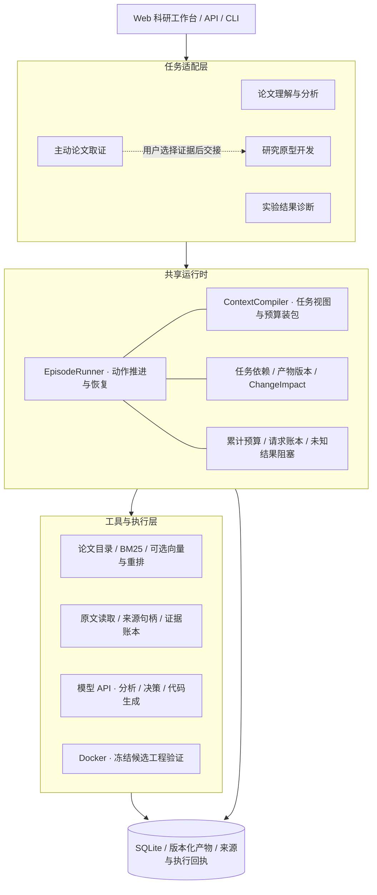
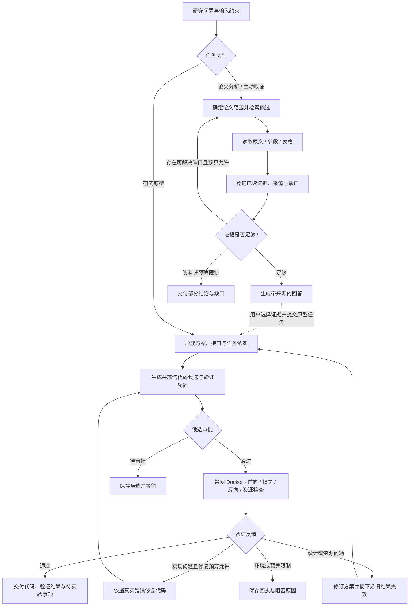
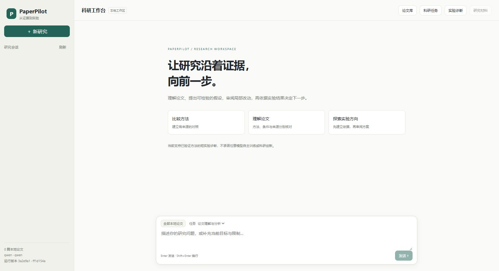

# PaperPilot

PaperPilot 是面向论文阅读与研究原型开发的科研 Agent，结合混合检索、主动取证和持久化任务运行时，支持从论文资料到模型原型的分阶段研究工作流。

## 核心功能

- 论文检索：BM25，以及可选向量召回与重排；检索结果用于定位，再按来源阅读原文。
- 主动取证：显式选择 `paper_active` 路径，记录证据需求、已读范围、支持判断和缺口。
- 长任务运行：共享 EpisodeRunner 和 ContextCompiler，管理动作、上下文视图、调用预算和已知结果恢复。
- 原型研发：将选定已读材料交接给设计、代码候选及验证任务；候选执行须单独审批。
- 工程验证：受限 CPU Docker 检查加载、形状、前向与反向等工程条件，保留失败回执。

论文阅读任务通过证据 ID 将选定材料交接给原型任务。原型验证覆盖代码接口与执行条件，训练效果和研究假设通过后续实验评估。

## 系统结构

工作台通过任务适配器连接论文分析、主动取证和研究原型能力。共享运行时管理上下文、预算、请求回执与任务版本。



普通论文问答与主动取证由任务配置选择；原型研发通过独立任务接收选定证据。角色表示任务职责，执行采用串行调度。

## 运行流程



每次模型或工具动作都经过预算、版本与状态检查。已保存的确定结果可在中断后复用；外部请求结果未知时暂停，等待确认。

## 项目界面

以下为项目实际 Web 工作台，在未导入论文、未配置 API 的独立工作区中截图。



## 安装与配置

需要 Python 3.11+。建议建立独立环境。

```powershell
python -m venv .venv
.\.venv\Scripts\Activate.ps1
python -m pip install -e ".[web,dev]"
Copy-Item .env.example .env
```

Linux/macOS 可使用 `source .venv/bin/activate` 和 `cp .env.example .env`。

编辑本机 `.env`：设置服务提供方、可用模型名称和 API Key。模板没有有效模型名或真实密钥；应按账户实际可用模型填写。不要提交 `.env`。如使用 DeepSeek，请同步修改 provider、base URL 和相应密钥变量。

论文由使用者自行提供，设置 `PAPERPILOT_PAPER_ROOTS`。首次索引和模型调用按界面操作发起；没有论文时不会得到论文证据。可选安装语义和重排依赖：

```powershell
python -m pip install -e ".[semantic,rerank]"
```

需要自行准备检索模型或明确允许下载，并在 `.env` 启用对应选项。模板默认关闭下载、语义检索、重排及外部学术检索。

## 启动

```powershell
paperpilot-web
```

打开 `http://127.0.0.1:8014`。CLI 用法可通过 `paperpilot --help` 查询。

Windows 也可运行 `启动PaperPilot.cmd`：它依次采用 `PAPERPILOT_PYTHON`、兼容变量 `PAPERPILOT_AGT_PYTHON`、项目 `.venv` 或 PATH 中的 Python。不要将开发服务器直接暴露到公网。

## 原型执行

默认以禁网 Docker 运行冻结候选，限制 CPU、内存和时间，关闭本地回退。执行前需要自行准备 PyTorch 容器镜像并批准具体候选；未具备环境时保留待执行或部分结果。模型生成的 Python 应在审阅后执行。容器限制不能替代对恶意代码的完整隔离审计。

## 本地检查

```powershell
$env:PYTHONPATH = 'src;tests;.;scripts'
python scripts/check_release_contents.py
python -m pytest tests/test_active_evidence.py tests/test_active_evidence_context.py tests/test_active_evidence_protocol.py -q
```

上述测试覆盖证据状态、上下文和工具协议。其他测试按需配置 Docker 或本地材料；`scripts/` 和 `evals/` 中的 live、paid、training 工具需单独配置，运行时可能调用模型 API 或执行实验程序。

## 项目结构与文档

- `src/paperpilot_agentic/`：Agent 运行时、论文检索、证据管理及 Web 工作台。
- `tests/`：运行协议、预算、恢复和工具行为的测试。
- `scripts/` 与 `evals/`：维护工具和评测程序，具体数据与 API 配置由使用者提供。
- `examples/`：受限实验工具示例。
- `demo/`：论文问答场景配置。
- [系统架构](docs/ARCHITECTURE.md)
- [数据与执行配置](docs/DATA_AND_EXECUTION.md)

## 许可

项目自有代码采用 [MIT](LICENSE)。第三方资源按各自许可分发，见 [THIRD_PARTY_NOTICES.md](THIRD_PARTY_NOTICES.md)。论文、数据集、第三方模型及服务不因本项目许可证而获得再分发授权。
